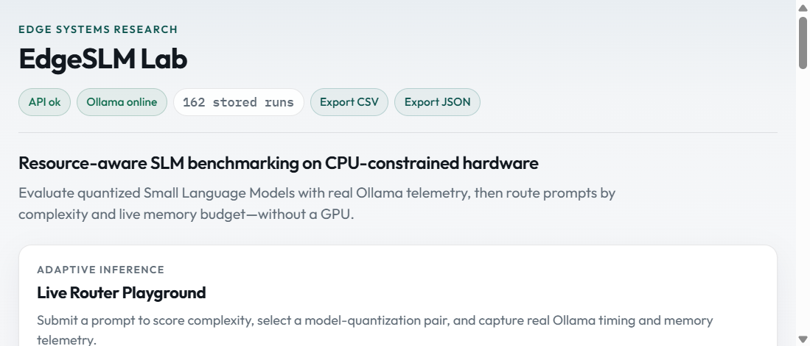
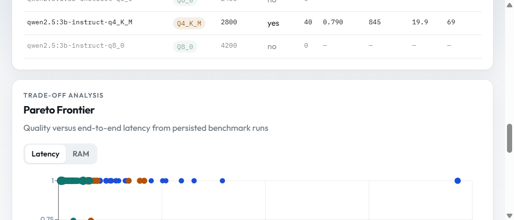
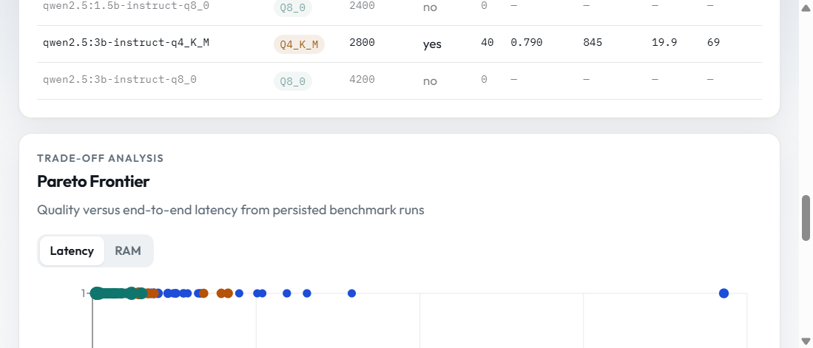

# EdgeSLM Lab
**Resource-Aware Small Language Model Benchmarking & Adaptive Inference on CPU-Constrained Edge Hardware**

EdgeSLM Lab is an AI systems benchmarking and adaptive routing framework built to evaluate quantized Small Language Models (SLMs) on consumer CPU hardware (no discrete GPU) and dynamically route incoming queries to the optimal model-quantization pair based on task complexity and real-time memory/CPU budgets.



---

## 1. Research Motivation & Core Questions
Deploying LLMs locally on edge laptops faces a strict **Quality–Latency–Memory trilemma**. Larger or higher-precision models (Q8_0) preserve reasoning quality but consume more RAM and stall Time-to-First-Token (TTFT), while aggressive quantization (Q4_K_M) improves throughput at the cost of structured-output accuracy.

This framework investigates:
1. **Quantization Trade-offs on Hybrid x86 CPUs:** How do `Q4_K_M` vs. `Q8_0` variants of 1B–3B SLMs (Llama 3.2, Qwen 2.5) trade off TTFT, decode speed (tokens/sec), process RSS memory, and task accuracy?
2. **Explainable Adaptive Routing:** Can a lightweight, non-LLM feature-and-telemetry router outperform static model selection in total latency and memory efficiency while maintaining ≥95% of peak task quality?

---

## 2. System Architecture

```text
[ User Prompt / Benchmark Suite ]
               │
               ▼
┌──────────────────────────────┐      ┌──────────────────────────────┐
│   Adaptive Feature Router    │◄─────┤   psutil Hardware Telemetry  │
│ (Complexity + Task + Budget) │      │ (Free RAM, CPU %, Runner RSS)│
└──────────────┬───────────────┘      └──────────────────────────────┘
               │ Selects (Model + Quantization)
               ▼
┌──────────────────────────────┐
│     Local Ollama Runtime     │ ──► Extracts load_duration, TTFT,
│   (GGUF: Q4_K_M / Q8_0 CPU)  │     eval_count, eval_duration
└──────────────┬───────────────┘
               │
               ▼
┌──────────────────────────────┐      ┌──────────────────────────────┐
│   Deterministic Evaluator    │─────►│   SQLite + React Dashboard   │
│ (F1 / JSON / ROUGE-L / Exact)│      │ (Pareto Charts & Live Trace) │
└──────────────────────────────┘      └──────────────────────────────┘
```

---

## 3. Target Hardware & Model Matrix

* **Testbed:** Intel Core i5-13420H (13th Gen), 24 GB System RAM, Integrated Graphics (CPU Inference).
* **Evaluated Models (via Ollama):**
  * `llama3.2:1b-instruct-q4_K_M` & `llama3.2:1b-instruct-q8_0`
  * `qwen2.5:1.5b-instruct-q4_K_M`
  * `qwen2.5:3b-instruct-q4_K_M`

---

## 4. Real Benchmark Results (CPU-only)

Measured from live Ollama `/api/generate` timings + `psutil` runner RSS on the testbed above. Suite: deterministic classification / extraction / summarization / reasoning prompts. Exported artifacts live in [`results/`](results/).

| Model | N | Mean Quality | Mean TTFT (ms) | Mean Tok/s | Mean Runner RSS (MB) |
|---|---:|---:|---:|---:|---:|
| `llama3.2:1b-instruct-q4_K_M` | 42 | 0.634 | 163 | 50.7 | 68.5 |
| `llama3.2:1b-instruct-q8_0` | 40 | 0.591 | 402 | 37.0 | 68.7 |
| `qwen2.5:1.5b-instruct-q4_K_M` | 40 | 0.716 | 421 | 40.5 | 69.0 |
| `qwen2.5:3b-instruct-q4_K_M` | 40 | 0.790 | 845 | 19.9 | 68.9 |

**Takeaways**
* **1B-Q4** is the latency/throughput winner (~51 tok/s, ~163 ms TTFT) for simple tasks.
* **1.5B-Q4** improves mean quality (+0.08 vs 1B-Q4) with moderate TTFT.
* **3B-Q4** reaches the highest quality (~0.79) but roughly 2× TTFT and half the decode speed of 1.5B.
* On this run, **1B-Q8 did not beat 1B-Q4 on mean quality** while roughly doubling TTFT—useful evidence for resource-aware routing away from higher precision on easy prompts.



---

## 5. Adaptive Routing Policy (Explainable Scoring)

Instead of using another LLM to route prompts (which adds latency), EdgeSLM Lab computes a deterministic **Complexity Score** $C \in [0, 1]$ from:

* Token/character length & lexical density
* Task category signals (Classification vs. JSON Extraction vs. Summarization vs. Multi-step Reasoning)
* **Hardware Gate:** Queries `/api/ps` and `psutil` available RAM. If free RAM drops below a model's safety threshold, the router gracefully downgrades and logs the fallback reason.

**Verified live routing ladder (installed models):**

| Difficulty | Example task | Routed model |
|---|---|---|
| Simple | Sentiment classification | `llama3.2:1b-instruct-q4_K_M` |
| Medium | JSON field extraction | `qwen2.5:1.5b-instruct-q4_K_M` |
| Hard | Multi-step numeric reasoning | `qwen2.5:3b-instruct-q4_K_M` |



---

## 6. Quick Start

### Prerequisites

1. Install [Ollama](https://ollama.com) and pull the target models:
```bash
ollama pull llama3.2:1b-instruct-q4_K_M
ollama pull llama3.2:1b-instruct-q8_0
ollama pull qwen2.5:1.5b-instruct-q4_K_M
ollama pull qwen2.5:3b-instruct-q4_K_M
```

### Run Backend

```bash
cd backend
python -m venv venv
source venv/bin/activate  # On Windows: venv\Scripts\activate
pip install -r requirements.txt
uvicorn app.main:app --reload --port 8000
```

### Run Tests

```bash
cd backend
pytest -v
```

### Run Frontend

```bash
cd frontend
npm install
npm run dev
```

Open http://127.0.0.1:5173

### Experiment export

```bash
curl -OJ http://localhost:8000/api/export/csv
curl -OJ http://localhost:8000/api/export/json
```

Or use **Export CSV** / **Export JSON** in the dashboard header. Checked-in copies are under [`results/`](results/).

---

## 7. Repository Layout

```text
edgeslm/
├── README.md
├── results/                 # Exported CSV/JSON experiment artifacts
├── docs/images/             # Dashboard screenshots for showcase
├── data/benchmark_suite.json
├── backend/                 # FastAPI + Ollama telemetry + router + pytest
└── frontend/                # Vite + React + Recharts research dashboard
```

---

## 8. Roadmap

* [x] Phase 1: Ollama telemetry client, psutil process RSS tracker, SQLite schema, and deterministic evaluator
* [x] Phase 2: Explainable resource-aware adaptive router & batch benchmark runner
* [x] Phase 3: React + Recharts research dashboard (Pareto frontier & live router trace)
* [x] Phase 4: Exportable CSV/JSON experiment artifacts for academic paper figures
